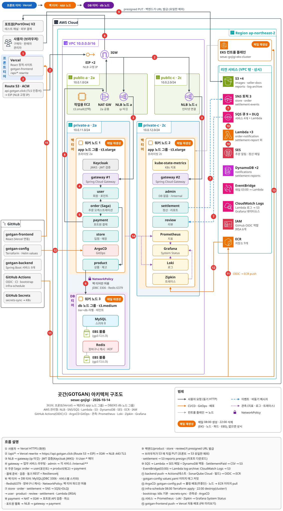

# 곳간 GOTGAN — config

곳간 프로젝트의 **인프라 · 배포 · 운영 설정** 저장소입니다. 코드는 [gotgan-backend](https://github.com/sesac-final-1/gotgan-backend) · [gotgan-frontend](https://github.com/sesac-final-1/gotgan-frontend), 설계 문서는 https://gotganguide.vercel.app/ 에 있습니다.

| 폴더 | 내용 | 실행 주체 | 담당 |
|---|---|---|---|
| `infra/terraform/` | AWS 자원 — `global/s3` → `vpc` → `ecr` → `app` → `cluster` (apply 순서). `cicd/` 는 독립(이경석) | `infra-schedule` 워크플로(OIDC) · 구지훈 (`cicd/` 는 이경석) | 구지훈 · `cicd/` 이경석 |
| `deploy/k8s/` | 기본 계층 — namespace · configmap · `02-networkpolicy`(DB 티어) · MySQL · Redis · Keycloak | `bootstrap` 워크플로 | 구지훈 · 이경석(keycloak) |
| `deploy/observability/` | Prometheus · Loki · Zipkin · Grafana · kube-state-metrics · System Status 대시보드 (blackbox exporter 없음) | `bootstrap` 워크플로 | 박지연 |
| `deploy/helm/sesac-gojigi-app/` | 서비스 9개 Deployment · Service · ServiceAccount — `values.yaml` 태그는 backend CI가 커밋 | ArgoCD | 이경석 |
| `deploy/argocd/` | ArgoCD Application ("이 저장소의 helm 폴더를 감시하라") | `bootstrap` 워크플로 | 이경석 |
| `scripts/` | scale-nodes · build-and-push (수동 보조) | 사람 | 구지훈 |
| `docs/` | ADR · 이벤트 목록 · 시크릿 목록(값 없음) · 인프라 · 로그 컨벤션 | 전원 | 전원 |
| `.github/workflows/` | `infra`(plan) · `infra-schedule`(07:00 apply · 21:00 destroy) · `bootstrap` · `secrets-sync` · `security` | GitHub | 구지훈 |

## 전체 아키텍처



**3티어**입니다 — 프론트 티어(Vercel) → 백 티어(EKS `app` 노드 그룹 t3.xlarge ×2: gateway · 업무 서비스 · Keycloak · 관측성 · ArgoCD) → DB 티어(EKS `db` 노드 그룹 t3.medium ×1: MySQL · Redis만, NetworkPolicy로 백 티어 파드만 3306 · 6379 접근). 프론트가 백 티어를 거치지 않는 유일한 예외는 파일 업로드(백엔드가 발급한 presigned URL로 브라우저 → S3 PUT). 주황 점선 프레임(EKS 클러스터 · 노드 · 파드 · EBS 볼륨)이 매일 07:00 생성 · 21:00 삭제되는 부분이고, 나머지(VPC · EIP · ECR · S3 · SNS/SQS · DynamoDB · IAM)는 상시입니다. 네트워크 · 서브넷 · 보안 그룹 상세는 [가이드라인 04장](https://gotganguide.vercel.app/guideline#s4).

## 매일 돌아가는 것

```
KST 07:00  infra-schedule(apply)  → terraform apply infra/terraform/cluster
           └→ bootstrap           → k8s 기본 계층(namespace · configmap · networkpolicy) → secrets-sync(GitHub Secrets → K8s Secret) → MySQL · Redis(db 노드) · Keycloak
                                    → observability → ArgoCD 설치 + Application → 서비스 9개 배포 (약 20분)
KST 21:00  infra-schedule(destroy) → ArgoCD 앱 · LoadBalancer Service · PVC 삭제 → terraform destroy cluster
```

- `vpc` · `ecr` · `cicd` · `app`(EIP · S3 · SNS/SQS · DynamoDB · SES · SSM)은 **상시 유지** — EIP · Route 53 레코드 · ACM 인증서가 남아 API 주소(`https://api.gotgan.click`)는 바뀌지 않습니다.
- 클러스터 안의 데이터(MySQL · Keycloak 사용자 · Grafana 설정)는 매일 초기화됩니다. 시연 데이터는 Flyway 시드(`R__demo_seed.sql`) · realm import · 대시보드 JSON으로 복원됩니다.
- 수동 실행: Actions → `infra-schedule` → Run workflow → `apply` / `destroy`.

## 시크릿

모든 비밀 값은 **GitHub Secrets**(이 저장소 + gotgan-backend)에만 둡니다. 목록 · 용도 · 생성 방법은 [docs/secrets.md](docs/secrets.md), 실제 값은 노션(팀 비공개). `secrets-sync` 워크플로가 K8s Secret으로 만들어 파드에 주입합니다.

## 로컬에서 확인할 것

```bash
cd infra/terraform/vpc && terraform init && terraform plan     # apply는 워크플로 또는 구지훈만 (컨벤션 5-2)
kubectl get pods -n sesac-gojigi                               # 팀원 전원 access entries 로 접근 가능
kubectl -n sesac-gojigi port-forward svc/keycloak 8180:8080    # Keycloak 콘솔 (외부 미노출)
kubectl -n monitoring port-forward svc/grafana 3000:3000       # Grafana
```

규칙은 [docs/CONVENTION.md](docs/CONVENTION.md)(인프라 네이밍 · 로그), 결정 기록은 [docs/adr](docs/adr), 이벤트 계약은 [docs/events.md](docs/events.md).
